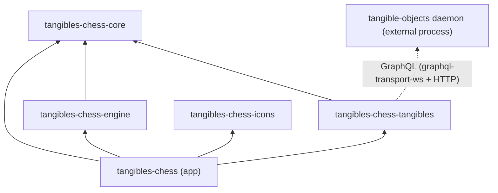
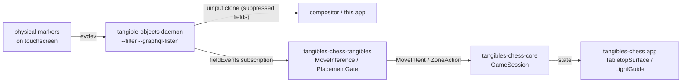

# Architecture

## Crate Dependency Graph

| Crate | Role | Depends on |
| ----- | ---- | ---------- |
| `tangibles-chess-core` | Game domain: `GameSession` over shakmaty, `MoveRequest`, `UndoPlan`, `GamePhase`, config enums, autosave | shakmaty |
| `tangibles-chess-tangibles` | `TangibleSource` (GraphQL + mock), `BoardGeometry`, `FieldSetBuilder`, `MoveInference`, `OccupancyProbe`, `PlacementGate` | core |
| `tangibles-chess-engine` | UCI subprocess client (stockfish, ...) | core, shakmaty |
| `tangibles-chess-icons` | Custom icon set built from fonts-rs sources via `icons.toml` | fonts-rs-* |
| `tangibles-chess` | GTK4/libadwaita tabletop app | all |

## Data flow (tangible modes)

